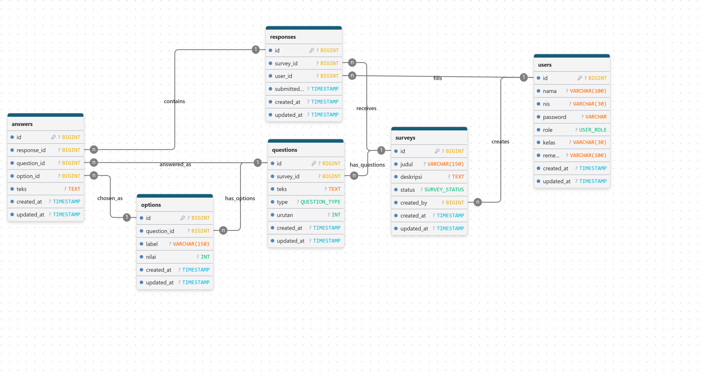
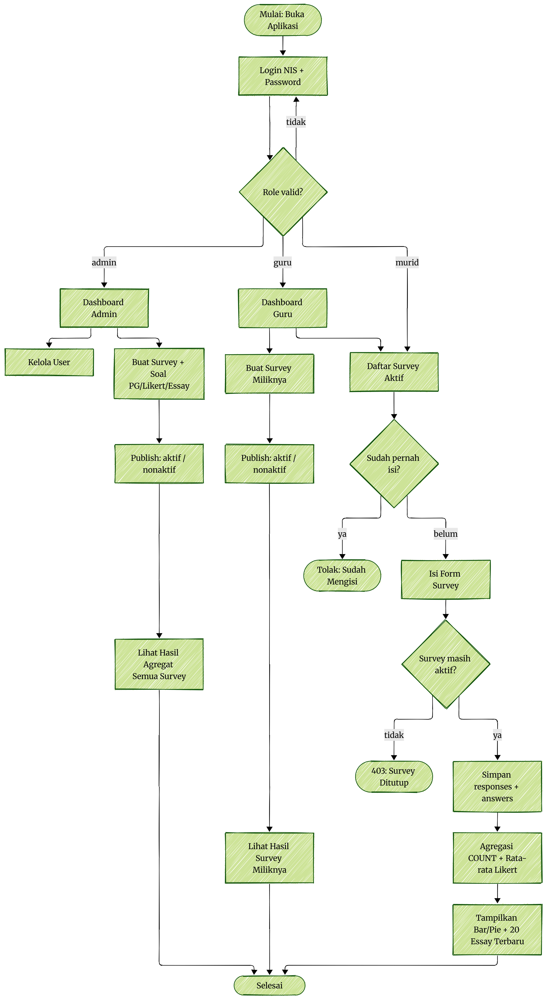

# Survei SMAKNIS

Aplikasi survei sekolah berbasis web untuk Ujikom. Admin dan guru membuat survei beserta soal PG / Likert / Essay, mempublish status aktif / nonaktif, dan melihat hasil agregat. Murid mengisi survei aktif satu kali per survei.

## Peran dan Fitur

| Peran | Akses |
|-------|-------|
| Admin | Dashboard admin, kelola user, buat semua survey + soal PG / Likert / Essay, publish aktif / nonaktif, lihat hasil agregat semua survey |
| Guru | Dashboard guru, buat survey miliknya, publish aktif / nonaktif, lihat hasil survey miliknya, isi survey aktif |
| Murid | Daftar survey aktif, isi form survey satu kali, tolak jika sudah mengisi, 403 jika survey ditutup |

Aturan pengisian:

- Satu user hanya bisa mengisi satu survey satu kali (`UNIQUE survey_id + user_id` di `responses`).
- Survey `nonaktif` tidak bisa diisi (respons 403 “Survey Ditutup”).
- Hasil menampilkan agregat `COUNT` + rata-rata Likert dalam Bar / Pie + 20 essay terbaru.

## Alur Aplikasi

```text
Buka Aplikasi
  -> Login NIS + Password
  -> Role valid?
     - tidak -> kembali ke login
     - admin -> Dashboard Admin -> Kelola User + Buat Survey -> Publish -> Hasil Semua -> Selesai
     - guru  -> Dashboard Guru -> Buat Survey Miliknya -> Publish -> Hasil Miliknya -> Selesai
     - murid -> Daftar Survey Aktif -> Sudah pernah isi?
                  ya    -> Tolak: Sudah Mengisi
                  belum -> Isi Form -> Masih aktif?
                             tidak -> 403 Ditutup
                             ya    -> Simpan responses + answers
                                    -> Agregasi COUNT + Rata-rata
                                    -> Bar / Pie + 20 Essay -> Selesai
```

Lihat diagram lengkap: `flowchart.png`.

## Desain Database

6 tabel utama, sesuai `erd.png`:

| Tabel | Kolom kunci | Relasi |
|-------|-------------|--------|
| `users` | `id PK, nama, nis UNIQUE, password, role ENUM(admin,guru,murid), kelas NULL` | `creates surveys`, `fills responses` |
| `surveys` | `id PK, judul, deskripsi NULL, status ENUM(aktif,nonaktif) DEFAULT nonaktif, created_by FK users CASCADE` | `has questions`, `receives responses` |
| `questions` | `id PK, survey_id FK surveys CASCADE, teks TEXT, type ENUM(pg,likert,essay), urutan INT DEFAULT 0` | `has options`, `answered_as answers` |
| `options` | `id PK, question_id FK questions CASCADE, label, nilai INT NULL` | `chosen_as answers` |
| `responses` | `id PK, survey_id FK CASCADE, user_id FK CASCADE, submitted_at, UNIQUE(survey_id,user_id)` | `contains answers` |
| `answers` | `id PK, response_id FK CASCADE, question_id FK CASCADE, option_id FK NULL ON DELETE SET NULL, teks TEXT NULL` | — |

Tabel pendukung Laravel (driver `database`): `sessions`, `cache`, `cache_locks`, `jobs`, `job_batches`, `failed_jobs`, `migrations`.





## Technology Stack

- Laravel 12 (`laravel/framework ^12.0`)
- PHP ^8.2 (teruji di 8.5)
- MySQL / MariaDB sebagai database utama (`DB_CONNECTION=mysql`)
- Session, Cache, Queue: driver `database`
- Vite + Tailwind CSS 4 untuk frontend
- PHPUnit 11 untuk testing

## Requirements

- PHP 8.2+ dengan ekstensi `pdo_mysql`
- Composer 2.x
- Node.js 22.x + npm
- MySQL / MariaDB berjalan (XAMPP / Laragon / server), port 3306
- Git

## Instalasi Lokal (MySQL)

```powershell
git clone https://github.com/ninostn/survei-smaknis.git survei-smaknis
cd survei-smaknis

composer install
copy .env.example .env
php artisan key:generate
```

Buat database kosong di phpMyAdmin, contoh `survei_smaknis`, lalu sesuaikan `.env`:

```env
DB_CONNECTION=mysql
DB_HOST=127.0.0.1
DB_PORT=3306
DB_DATABASE=survei_smaknis
DB_USERNAME=root
DB_PASSWORD=
```

Lanjut:

```powershell
php artisan migrate
php artisan storage:link

npm install
npm run dev
php artisan serve
```

Buka `http://127.0.0.1:8000`.

Untuk build produksi:

```powershell
npm run build
php artisan serve
```

## Konfigurasi Penting

| Key | Nilai contoh | Keterangan |
|-----|--------------|------------|
| `APP_NAME` | `Survei-SMAKNIS` | Nama aplikasi |
| `APP_URL` | `http://localhost` | URL dasar |
| `DB_CONNECTION` | `mysql` | Koneksi utama |
| `DB_DATABASE` | `survei_smaknis` | Nama database |
| `SESSION_DRIVER` | `database` | Butuh tabel `sessions` |
| `CACHE_STORE` | `database` | Butuh tabel `cache` |
| `QUEUE_CONNECTION` | `database` | Butuh tabel `jobs` |

## Status Progres

| Area | Status | Keterangan |
|------|--------|------------|
| Migrasi database | Selesai | 8 migrasi `Ran`, sinkron ERD: `users` custom + `surveys, questions, options, responses, answers` + `cache, jobs, sessions` |
| Model Eloquent | Selesai | 6 model: `User, Survey, Question, Option, Response, Answer` beserta relasi `hasMany / belongsTo` |
| Seeder user | Selesai | 3 akun: `1001` admin, `1002` guru, `1003` murid, password `password123` |
| Auth NIS + middleware role | Selesai | Login `nis + password`, cabang `admin / guru / murid`, middleware `role:` |
| CRUD survey + publish | Selesai | `surveys.*` 7 route, policy pemilik, status `aktif / nonaktif` |
| CRUD soal + opsi | Belum | M2 (`questions`) dan M3 (`options`) belum di-merge |
| Isi survey murid | Selesai | `murid.surveys.*`, transaksi `responses + answers`, 403 `Survey Ditutup`, tolak double |
| Hasil agregat | Sebagian | `COUNT` + rata-rata Likert + 20 esai terbaru. Bar / Pie belum |
| Kelola user | Belum | M1 belum di-merge |
| Polish UI | Belum | Masih HTML polos sesuai kerangka |

## Verifikasi Cepat

```powershell
php artisan migrate:status
php artisan db:table users
php artisan db:table surveys
php artisan db:table questions
php artisan db:table options
php artisan db:table responses
php artisan db:table answers
```

Hasil yang diharapkan: 8 migrasi `[1] Ran`, struktur tiap tabel sesuai bagian Desain Database.

## Struktur Proyek

```text
app/Models/            User, Survey, Question, Option, Response, Answer
database/migrations/   8 file: cache, jobs, users custom, surveys, questions, options, responses, answers
database/seeders/      DatabaseSeeder (rencana 3 role)
routes/web.php         Rute aplikasi (saat ini minimal)
resources/views/       Blade templates
resources/css/         Tailwind CSS
resources/js/          Vite entry
erd.png                ERD acuan
flowchart.png          Flowchart acuan
```

## Lisensi

MIT License. Berbasis Laravel framework.
